# TurtleBot3 visual waypoint navigation and ArUco docking (41014 Integrated Project, Track A)

**Group:** solo submission (approved by Teresa Vidal Calleja)  
**Team:** Ferdinand Auld (25560032), sole member  
**Demo video (5 min):** to be added. Raw demo clips: [nominal](results/video/nominal.mp4), [disturbed](results/video/disturbed.mp4), [camera blind](results/video/blind.mp4)  
**Repository (code, and the version where the diagrams render):** https://github.com/fnordystew888/tb3-visual-docking  
**Track:** A, mobile robot. TurtleBot3 Burger with 2D LiDAR and camera in MuJoCo. It navigates a room with unknown obstacles using the LiDAR and docks visually at an ArUco-marked charging station. **Simulation only** (no hardware component).

---

## 1. What the system does

The robot starts somewhere on a start pad (±0.15 m, ±0.3 m, ±17° around (−1.85, 0, 0); the robot only knows the pad, not its exact pose). It has to cross a 5 m × 4 m room containing three obstacles it has never seen, then dock in front of the charging station marker with less than 5 cm position error and less than 10° heading error. Obstacles are randomised every trial, and one of them always blocks the straight line to the dock.

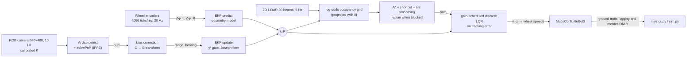

**Constraint check.** The controller, planner and EKF only ever see `ekf.x`. Ground truth is read in `src/tb3nav/sim.py` on lines marked `# GROUND TRUTH (evaluation only)`, for three things only: placing the robot at its random start, choosing the direction of the disturbance push, and logging the metrics. `grep -n "GROUND TRUTH" -r src scripts` lists every use.

## 2. Install and run

Tested with Python 3.13, MuJoCo 3.17, OpenCV 5.0 on Linux (headless, OSMesa). macOS uses MuJoCo's native renderer and needs nothing extra.

```bash
git clone https://github.com/fnordystew888/tb3-visual-docking.git && cd tb3-visual-docking
python -m venv .venv && source .venv/bin/activate
pip install -r requirements.txt
# headless Linux only: sudo apt install libosmesa6   (the package picks OSMesa automatically)

python scripts/calibrate_camera.py        # Part B: intrinsics  -> results/data/camera_calib.json
python scripts/characterise_sensors.py    # Part B: R model     -> results/data/camera_noise_model.json
python scripts/measurement_correlation.py # Part B/C: is the camera noise white? (~1 min)
python scripts/analyse_model.py           # Part A: controllability / observability / LQR poles
python scripts/run_demo.py --condition nominal     # one trial + video -> results/video/nominal.mp4
python scripts/run_demo.py --condition disturbed   # push + radius error + frame drop + image noise
python scripts/run_experiments.py --trials 15      # Part E: all repeated trials (~35 min on 2 cores)
python scripts/make_plots.py                       # tables (results/summary.md) and figures
```

All trials are seeded, so re-running gives the same numbers. Calibration and noise files are committed, so the pipeline runs without re-calibrating.

```
src/tb3nav/
  scene.py       MJCF generator: room, obstacles, ArUco landmarks + dock, TB3 Burger, LiDAR, camera
  sensors.py     encoders, LiDAR noise model, camera + ArUco + PnP + C->B transform
  model.py       kinematics, odometry model + Jacobians, range-bearing model, error model, LQR
  ekf.py         EKF with chi-square gating and gate lock-out recovery
  planner.py     log-odds occupancy grid, A*, shortcutting, arc smoothing
  controller.py  gain-scheduled discrete LQR path tracker
  sim.py         the closed loop, disturbances, logging, metrics
  plots.py       trajectory / error-with-3-sigma plots
scripts/         calibration, characterisation, analysis, experiments, demo, plots
results/         data (json/csv), figures, video, summary.md
```

## 3. Frames

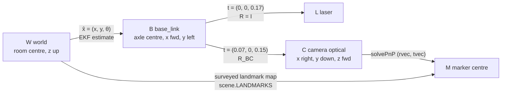

`R_BC = [[0,0,1],[-1,0,0],[0,-1,0]]` (x_B = z_C, y_B = −x_C, z_B = −y_C). A marker detection goes p_C (from PnP) → bias correction → p_B = R_BC p_C + t_BC → planar range r = ‖p_B,xy‖ and bearing β = atan2(y_B, x_B). The EKF predicts the same quantities from x̂ and the landmark's world position (`model.h_range_bearing`). LiDAR returns are in L, rotated by x̂ into W, and accumulated in the grid. `characterise_sensors.py` checks the frame chain end to end. A sign or offset error in R_BC or t_BC would show up there as a bearing bias or a range bias that depends on bearing. Measured bearing bias is −0.002°.

## 4. Part A: Modelling

**Platform model.** The state is x = [x, y, θ] (base pose in W) and the input is u = [v, ω]. Wheel speeds map to the input as v = r(ω_R + ω_L)/2 and ω = r(ω_R − ω_L)/b, with r = 0.033 m and b = 0.160 m (TurtleBot3 Burger datasheet). The kinematics are

ẋ = v cos θ,  ẏ = v sin θ,  θ̇ = ω.

The EKF uses the discrete odometry form, driven by measured encoder increments with midpoint integration (`model.f_discrete`).

**Assumptions (each is deliberately broken in one experiment):** wheels roll without slip (low friction, push), wheel radius is known (+3% radius error), the floor is flat and rigid, and the motors track commanded wheel speed much faster than the 20 Hz control rate. The MuJoCo wheel actuators are velocity servos with kv = 0.6 Nm·s/rad, 1.4 Nm torque limit and 0.005 kg·m² armature, giving a time constant of about 8 ms.

**Tracking-error model (controller design).** The tracking error is expressed in the robot frame, e = [R(θ)ᵀ(p_ref − p); θ_ref − θ], following Kanayama et al. [1]. With u₁ = v_r cos e₃ − v and u₂ = ω_r − ω, linearising about e = 0 gives

A(v_r, ω_r) = [[0, ω_r, 0], [−ω_r, 0, v_r], [0, 0, 0]],  B = [[1, 0], [0, 0], [0, 1]].

**Controllability** (`scripts/analyse_model.py`, `results/data/model_analysis.json`):

| operating point | rank 𝒞 | σ_min(𝒞) |
|---|---|---|
| cruise v_r = 0.15, ω_r = 0 | 3 | 0.150 |
| turning v_r = 0.15, ω_r = 0.6 | 3 | 0.619 |
| turn on the spot v_r = 0, ω_r = 0.5 | 3 | 0.500 |
| stopped v_r = ω_r = 0 | **2** | 0 |

The stopped case loses rank. A differential drive cannot move sideways (the nonholonomic constraint), so no smooth time-invariant state feedback can stabilise a pose at rest (Brockett [2]). Two design consequences follow. (i) The LQR gain is computed with v_r floored at 0.02 m/s. (ii) Docking is not posed as regulation to a pose. It is the last straight segment of a path, flown at 0.08 m/s, so v_r > 0 and the error model stays controllable until the robot stops within 1 cm of the end. σ_min grows linearly with v_r (`results/figures/controllability.png`), so lateral authority at dock speed is about half of that at cruise.

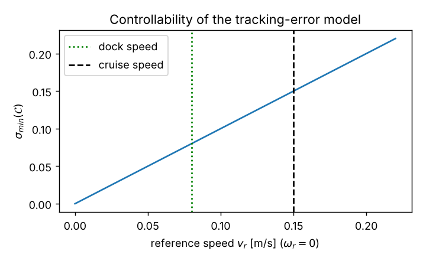

**Observability of the estimator.** This uses the stacked linearised measurement Jacobians H_k Φ_k over 10 steps:

| sensing situation | rank 𝒪 | comment |
|---|---|---|
| no marker | 0 | pure dead reckoning, P grows |
| one marker, stationary | 2 | null space ≈ (0.89, −0.13, 0.44): rotation about the marker |
| **one marker, moving** | **2** | still unobservable: rotating the whole trajectory about the marker leaves ranges, bearings *and* body-frame odometry unchanged |
| marker A, then marker B, moving | 3 | odometry links the two fixes |
| two markers at once | 3 | |

So a single landmark never fixes the full pose, however the robot moves. This is why there are eight wall markers plus the dock marker, with markers 7 and 8 placed near the dock end of the room. On the final approach the dock marker alone cannot correct the "rotate about the dock" direction, and the docking accuracy depends on the wall-marker fixes made just before.

## 5. Part B: Sensing

**Camera intrinsics.** `calibrate_camera.py` renders a 9×7 checkerboard (30 mm squares) at 40 random poses (0.35 to 0.9 m, up to about 35° tilt) and runs `cv2.calibrateCamera`.

| | f_x [px] | f_y [px] | c_x [px] | c_y [px] | reproj. RMS |
|---|---|---|---|---|---|
| calibrated | 399.32 | 399.37 | 319.50 | 239.84 | 0.052 px |
| nominal from MuJoCo fovy = 62° | 399.43 | 399.43 | 320.00 | 240.00 | |

The calibrated K, not the nominal one, is loaded at runtime (`sensors.load_calibration`). Distortion coefficients are all below 0.03, consistent with MuJoCo's ideal pinhole. They are kept rather than forced to zero so the same code would work on the real Pi camera.

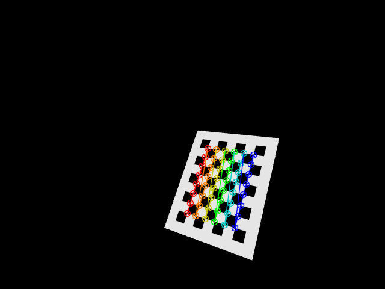

**Marker measurement and a bias found by characterisation.** `characterise_sensors.py` places the robot at 600 random poses (30% of them biased towards the dock, for short ranges) and compares every detection with the simulator's true range and bearing. That gave 925 detections.

* The raw pipeline over-estimated range by **+51 mm on average**, growing with distance (+0.1% at 0.4 m, +1.9% at 3.5 m). The error scaled with 1/(marker size in pixels), not with range, which pointed at the corner detector. ArUco corners on a rendered, anti-aliased edge sit inside the true square, so the marker looks smaller and therefore further away. Modelling the apparent side as s_true − δ and fitting δ by least squares gave **δ = 0.37 px**. The PnP translation is rescaled by s/(s + δ) (`sensors.Camera.detect`). After correction the mean range bias is **0.45 mm**.
* **Noise model.** Binned RMS range error is fitted as σ_r(r) = a + b r², with a = 2 mm and b = 5.6 mm/m². The r² follows from depth error ∝ r²/(f·S) for fixed pixel noise. Bearing RMS is 0.026° and roughly constant with range.
* **Detection limit.** Wall markers (0.20 m) are detected out to about 4 m (≈15 px). Below about 0.13 m the dock marker leaves the field of view, so the last few centimetres of docking run on odometry.

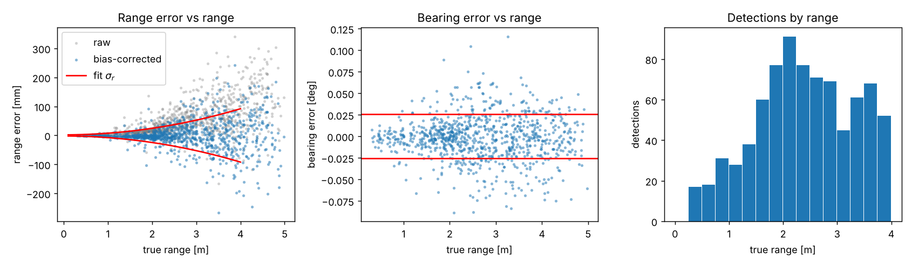

**Is the noise white? No.** The EKF assumes independent measurement errors at 10 Hz. `measurement_correlation.py` records the error of every detection along four nominal runs and computes its autocorrelation per marker track. The lag-1 correlation is 0.34 (range) and 0.29 (bearing), and a tail of ≈ 0.2 persists past 1.5 s. The error depends on viewing geometry, which changes slowly as the robot drives, so successive frames repeat much of the same error. An AR(1) correction alone would justify inflating R by about 2. The persistent tail means long tracks contribute far fewer independent samples than frames. Section 6 sets the final R scale from NEES.

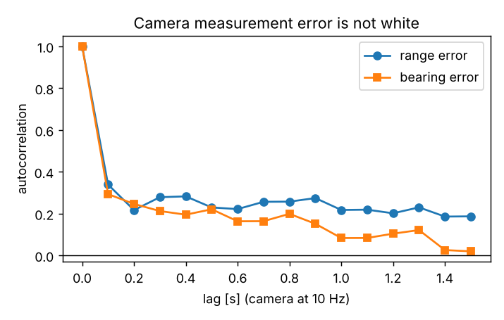

**LiDAR.** The model is LDS-01-like: 90 beams over 360° (4°, reduced from the real 1° to keep the simulation fast), 0.12 to 3.5 m range, 5 Hz, σ = 1 cm + 1%·r, and 1% dropouts. *This noise is modelled from the datasheet accuracy (±15 mm under 0.5 m, ±5% beyond), not measured.* MuJoCo's rangefinder is exact, so "characterising" it would only return the noise we injected. The grid uses log-odds (+0.85 hit, −0.4 miss, clamped to [−4, 6], occupied above 1.5) so that single noisy returns and dropouts don't create or erase obstacles.

**Encoders.** 4096 ticks/rev quantisation (Dynamixel XL430). Wheel slip comes from the contact physics, not from injected noise.

## 6. Part C: Estimation

The EKF state is [x, y, θ] (`src/tb3nav/ekf.py`).

* **Predict** at 20 Hz from encoder increments. Process noise is defined in wheel space, M = diag(k|Δφ_L| + s₀², k|Δφ_R| + s₀²), and mapped through G J. Uncertainty therefore grows with distance travelled, as it should for slip and radius error, and not with elapsed time while stopped. k = 2×10⁻³ rad²/rad and s₀ = 10⁻³ rad. The odometry-only trials end with NEES = 1.7, which is slightly conservative. A 3% radius error over a 4 m run (12 cm of drift) stays inside 3σ.
* **Update** at 10 Hz. Each marker gives a range-bearing measurement against its surveyed position, with R(r) = k_R · diag((2σ_r(r))², (2σ_b)²) and floors of 5 mm and 0.005 rad. The floors stand in for extrinsic and timing errors the simulator doesn't model. There is a χ² innovation gate at 9.21 (2 dof, 99%) and the Joseph-form covariance update.
* **Initialisation.** x̂₀ = start-pad centre, P₀ = diag(0.15², 0.3², 0.3²), matching the real spread of start poses. No ground truth is used.

**Tuning R (consistency vs responsiveness).** R from the static characterisation assumes independent errors, but Section 5 shows they are not independent. The sweep over the scale k_R below, run on a disturbed condition (8 N push and +3% radius error), shows the trade-off:

| condition | n | success | dock error [cm] | est. RMSE after 3 s [cm] | max est. error [cm] | est. yaw RMSE [deg] | mean NEES | NEES < 7.81 | true path error [cm] | LQR cross-track on estimate [cm] | time [s] | EKF resets | collisions |
|---|---|---|---|---|---|---|---|---|---|---|---|---|---|
| Rx0.01 | 7 | 2/7 | 16.5 ± 19.5 | 64.8 ± 16.5 | 174.1 ± 25.7 | 25.2 ± 8.1 | 25153.97 | 9% | 30.3 ± 15.7 | 22.0 ± 6.4 | 36.5 | 23.1 | 0 |
| Rx0.1 | 7 | 6/7 | 2.2 ± 1.2 | 15.3 ± 9.5 | 71.6 ± 32.9 | 6.5 ± 3.6 | 57.57 | 26% | 9.1 ± 6.9 | 6.6 ± 3.0 | 34.2 | 7.0 | 0 |
| Rx1 | 7 | 7/7 | 1.1 ± 0.4 | 6.8 ± 1.7 | 42.0 ± 17.8 | 3.3 ± 1.2 | 9.66 | 70% | 5.3 ± 1.8 | 3.4 ± 1.1 | 34.2 | 2.3 | 0 |
| Rx3 | 7 | 7/7 | 1.4 ± 0.2 | 5.6 ± 1.9 | 22.3 ± 3.4 | 2.6 ± 0.6 | 6.98 | 80% | 3.4 ± 1.4 | 2.2 ± 1.0 | 33.5 | 1.3 | 0 |
| Rx10 | 7 | 7/7 | 1.3 ± 0.5 | 7.4 ± 2.3 | 31.7 ± 8.2 | 3.5 ± 1.1 | 4.83 | 95% | 6.0 ± 2.7 | 3.1 ± 1.4 | 33.8 | 1.0 | 0 |
| Rx30 | 7 | 7/7 | 1.4 ± 0.3 | 7.1 ± 2.0 | 23.2 ± 3.0 | 3.7 ± 1.0 | 3.14 | 98% | 6.1 ± 2.0 | 2.0 ± 0.7 | 33.6 | 1.0 | 0 |
| Rx100 | 7 | 7/7 | 1.3 ± 0.4 | 7.6 ± 2.8 | 22.5 ± 4.7 | 3.9 ± 1.2 | 2.70 | 98% | 7.2 ± 2.8 | 1.6 ± 0.5 | 33.4 | 1.0 | 0 |

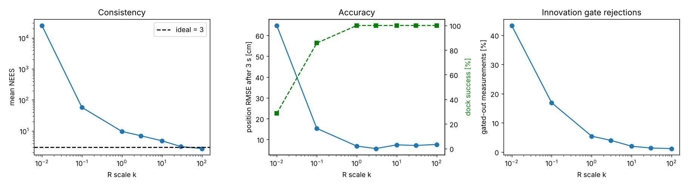

The sweep was run on the 8 N push with +3% radius error, 7 seeds per k:

* **k ≤ 0.1 (overconfident):** NEES runs to 58 and beyond and 17 to 43% of measurements are gated out. The filter rejects the data it needs and resets repeatedly. Dock success drops to 6/7 (k = 0.1) and 2/7 (k = 0.01).
* **k = 1 (R exactly as characterised):** every trial docks, but NEES is 9.7 with only 70% of steps inside the 95% bound. That is the correlated-noise overconfidence predicted in Section 5.
* **k = 3:** the best accuracy (5.6 cm RMSE) but still overconfident (NEES 7.0, 80%).
* **k = 10:** the first value where 95% of steps fall inside the bound (NEES 4.8), costing about 2 cm of RMSE compared with k = 3. Very few measurements are gated out, and there is one reset per push.
* **k ≥ 30:** NEES reaches 3 (consistent), RMSE doesn't improve, and the true path error grows (6.1 to 7.2 cm) because the filter responds more slowly after the push.

**Chosen: k_R = 10.** It is the smallest scale at which the filter is statistically consistent. The 2 cm of accuracy given up relative to k = 3 doesn't affect docking (1.3 vs 1.4 cm), while an overconfident filter is the one that fails the gate and locks out.

**Failure found and fixed: gate lock-out.** An 8 N sideways push (0.3 s) makes the wheels skid and the robot slews by up to about 30°. The encoders don't see the slide, so the estimate is suddenly tens of centimetres and degrees away from the truth while P is still small. Every subsequent marker innovation then fails the χ² gate, the filter rejects the very measurements that would correct it, and the robot "docks" up to a metre off. *Fix:* if markers are visible but every innovation fails the gate for 3 consecutive camera frames (0.3 s), the estimate is assumed to be at fault, not the camera, and P is inflated by diag(0.5², 0.5², 0.6²) so the next measurements can pull it back (`EKFParams.lockout_frames`). The ablation in Section 8 quantifies it: without recovery, 1/15 trials dock, with a mean dock error of 80 cm and mean NEES of 61. With recovery, 15/15 dock, with 1.6 cm dock error and NEES 3.5, using on average 1.1 resets per trial.

## 7. Part D: Control

The tracker is a discrete LQR at 20 Hz on the linearised error model of Section 4, discretised by zero-order hold. It is gain-scheduled on (v_r, ω_r), with gains cached on a 0.01 m/s × 0.1 rad/s grid. The reference is the closest point on the path to x̂ (searched forward in a window so it never jumps back). Speed comes from v_r = min(0.15, 0.6·s_remaining + 0.02) m/s, dropping to 0.08 m/s on the docking segment, and ω_r = v_r κ from the smoothed path curvature. Outputs are saturated to the TB3 limits (0.22 m/s, 2.84 rad/s).

* **Weights.** Q = diag(4, 25, 2) on (along-track, cross-track, heading) and R = diag(1, 0.08) on (u₁, u₂). Cross-track error is what causes collisions and missed docks, so it carries the most weight. Along-track error only changes arrival time. R_ω is small because the TB3 has relatively more angular than linear authority.
* **Closed loop at cruise** (v_r = 0.15): K = [[1.90, 0, 0], [0, 15.4, 4.86]], |poles| = 0.905, 0.780, 0.974, time constants 0.5, 0.2 and 1.9 s. The slow pole is the coupled lateral/heading mode. Lateral error can only be removed by driving forward with a heading offset, so it is limited by v_r: at dock speed that time constant is 3.5 s.
* **Path.** A* runs on a 5 cm grid inflated by 0.17 m (robot radius plus 8 cm), followed by line-of-sight shortcutting. Corners are replaced by circular arcs of radius up to 0.25 m so the curvature stays bounded. The planner replans whenever a LiDAR update marks a cell on the remaining path as occupied.
* **Lesson from development.** A constant 4 cm reference lookahead produced a permanent along-track error, so v = v_r + K₁e₁ ran at about 0.19 m/s instead of 0.15. The lookahead was removed.

**Failure found and fixed: LQR deadlock.** In the first full batch, 2 of 241 trials stopped dead about 1 m short of the dock and timed out (`q_lat = 250` seed 1004, and the combined condition seed 1014). The log showed v = ω = 0 with a non-zero error e = (0.09, −0.05, 0.30). The gain K is 2 × 3, so the linear law has a one-dimensional null space. At that particular error the feedforward and feedback cancelled exactly, the robot stopped, and because the reference is the closest point on the path it stopped advancing too. Nothing in the loop could leave that equilibrium. *Fix:* a progress floor, v ≥ min(0.03, v_r), applied while the heading error is under 60° (`LQRParams.v_min`). The same two seeds now dock. All results on this page are from the re-run with the fix.

**LiDAR bumper.** In the combined condition the push can shove the robot against an obstacle. Its wheels then spin against the obstacle, the encoders report motion that isn't happening, and the camera is facing a box, so it sees no markers. In the first batch, two combined trials (seeds 1012 and 1013) ended about 2 m from the dock this way. Now, if the LiDAR's ±40° forward cone reports anything within 0.21 m of the axle (12 cm from the chassis) outside the docking segment, the robot backs up at 0.05 m/s for 1 s and replans. The bumper fired 18 times across the 15 combined trials. Six of those trials still touched an obstacle briefly, but all of them recovered.

**Weight trade-off (q_lat sweep, 8 N push, 7 seeds each):**

| condition | n | success | dock error [cm] | est. RMSE after 3 s [cm] | max est. error [cm] | est. yaw RMSE [deg] | mean NEES | NEES < 7.81 | true path error [cm] | LQR cross-track on estimate [cm] | time [s] | EKF resets | collisions |
|---|---|---|---|---|---|---|---|---|---|---|---|---|---|
| q_lat0.25 | 7 | 6/7 | 3.8 ± 2.1 | 9.1 ± 3.0 | 27.3 ± 6.7 | 4.8 ± 1.6 | 5.15 | 95% | 6.4 ± 2.5 | 5.6 ± 3.2 | 34.3 | 1.1 | 0 |
| q_lat2.5 | 7 | 7/7 | 1.5 ± 0.5 | 9.2 ± 3.5 | 27.4 ± 4.3 | 4.0 ± 1.4 | 2.56 | 97% | 6.5 ± 3.0 | 3.9 ± 1.9 | 34.0 | 1.0 | 0 |
| q_lat25 | 7 | 7/7 | 1.3 ± 0.4 | 5.7 ± 2.6 | 33.3 ± 11.6 | 2.7 ± 0.6 | 3.72 | 95% | 4.2 ± 2.9 | 3.0 ± 1.9 | 34.5 | 1.1 | 0 |
| q_lat250 | 7 | 7/7 | 1.4 ± 0.3 | 4.9 ± 1.6 | 26.6 ± 6.9 | 2.9 ± 0.4 | 5.43 | 92% | 2.9 ± 0.8 | 1.8 ± 0.7 | 35.8 | 1.9 | 0 |
| q_lat2500 | 7 | 7/7 | 1.7 ± 0.4 | 9.1 ± 5.4 | 39.8 ± 23.2 | 4.0 ± 1.7 | 12.33 | 68% | 6.7 ± 5.6 | 2.9 ± 1.6 | 39.1 | 4.4 | 1 |

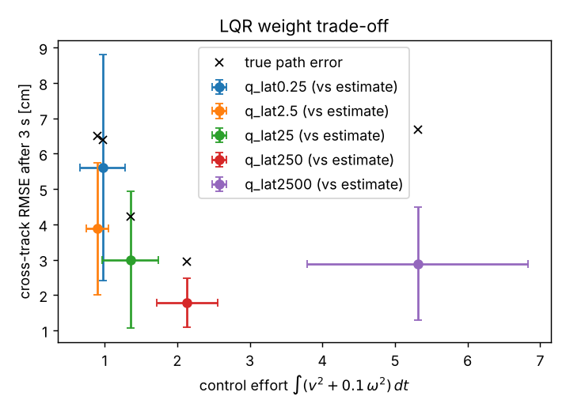

Raising q_lat from 0.25 to 250 cuts the cross-track error the controller sees from 5.6 to 1.8 cm, while control effort ∫(v² + 0.1ω²)dt rises from 0.98 to 2.14. At q_lat = 2500 the effort reaches 5.3 for no further gain. The controller then reacts hard to every estimate correction, causing more EKF resets (4.4 per trial), a less consistent filter (NEES 12.3), the only obstacle contact in the sweep and slower runs (39 s). With q_lat = 0.25 one run docks 9.8 cm off: lateral error isn't corrected before the dock. **The true path error is always several cm larger than the error the controller sees.** That means tracking is limited by estimation, not control, so pushing gains higher buys little. The default q_lat = 25 sits on the knee: 1.4× the effort of the gentlest setting, a 3 cm cross-track error against the estimate, and no failures. q_lat = 250 performed slightly better on true path error here (2.9 vs 4.2 cm, with overlapping confidence intervals) at 1.6× the effort, so it is a defensible alternative.

## 8. Part E: Integration and robustness

Each condition is run over seeded trials that randomise the start pose and obstacle layout. Mean ± 95% CI. Success means docked with less than 5 cm true position error and less than 10° yaw error. The full table with every column is in `results/summary.md`, and raw rows are in `results/data/experiments.csv`.

| condition | n | success | dock error [cm] | est. RMSE after 3 s [cm] | max est. error [cm] | est. yaw RMSE [deg] | mean NEES | NEES < 7.81 | true path error [cm] | LQR cross-track on estimate [cm] | time [s] | EKF resets | collisions |
|---|---|---|---|---|---|---|---|---|---|---|---|---|---|
| nominal | 15 | 15/15 | 1.4 ± 0.2 | 2.0 ± 0.7 | 17.3 ± 3.0 | 0.8 ± 0.2 | 1.62 | 98% | 1.7 ± 0.6 | 0.4 ± 0.1 | 33.6 | 0.0 | 0 |
| push_8N | 15 | 15/15 | 1.6 ± 0.4 | 6.1 ± 2.4 | 29.1 ± 6.3 | 3.0 ± 0.9 | 3.47 | 95% | 5.0 ± 2.3 | 2.7 ± 1.0 | 34.2 | 1.1 | 0 |
| push_8N_no_recovery | 15 | 1/15 | 80.2 ± 14.1 | 43.5 ± 7.0 | 81.4 ± 11.9 | 17.4 ± 2.2 | 61.39 | 35% | 41.4 ± 6.5 | 0.6 ± 0.3 | 34.0 | 0.0 | 0 |
| wheel_radius_+3% | 15 | 15/15 | 0.9 ± 0.2 | 2.8 ± 0.4 | 16.6 ± 2.4 | 0.9 ± 0.1 | 2.90 | 95% | 1.9 ± 0.4 | 0.5 ± 0.1 | 32.7 | 0.0 | 0 |
| low_friction_0.3 | 15 | 15/15 | 1.2 ± 0.2 | 3.4 ± 0.8 | 17.4 ± 2.5 | 0.9 ± 0.1 | 3.58 | 94% | 2.3 ± 0.7 | 0.6 ± 0.2 | 33.7 | 0.0 | 0 |
| frame_drop_50% | 15 | 15/15 | 1.2 ± 0.1 | 1.9 ± 0.5 | 19.6 ± 4.1 | 1.0 ± 0.2 | 0.98 | 99% | 1.5 ± 0.3 | 0.3 ± 0.1 | 33.5 | 0.0 | 0 |
| blind_8s | 15 | 15/15 | 1.3 ± 0.2 | 2.3 ± 0.8 | 17.3 ± 3.0 | 0.9 ± 0.2 | 1.52 | 99% | 1.9 ± 0.7 | 0.4 ± 0.1 | 33.6 | 0.0 | 0 |
| image_noise_blur | 15 | 15/15 | 1.4 ± 0.2 | 5.1 ± 1.5 | 21.1 ± 3.2 | 1.7 ± 0.3 | 0.97 | 100% | 4.5 ± 1.4 | 0.7 ± 0.2 | 33.5 | 0.0 | 0 |
| dim_light_40% | 15 | 15/15 | 1.4 ± 0.2 | 3.0 ± 1.0 | 17.1 ± 3.3 | 0.9 ± 0.2 | 1.68 | 99% | 2.8 ± 0.9 | 0.5 ± 0.2 | 33.4 | 0.0 | 0 |
| combined | 15 | 15/15 | 1.1 ± 0.4 | 10.8 ± 3.0 | 34.2 ± 5.5 | 9.7 ± 2.5 | 14.33 | 89% | 7.9 ± 1.5 | 3.3 ± 0.9 | 35.5 | 1.0 | 6 |
| odometry_only | 7 | 0/7 | 82.3 ± 16.0 | 59.1 ± 12.5 | 82.2 ± 16.0 | 10.5 ± 2.5 | 1.71 | 100% | 55.8 ± 13.0 | 0.0 ± 0.1 | 32.9 | 0.0 | 0 |

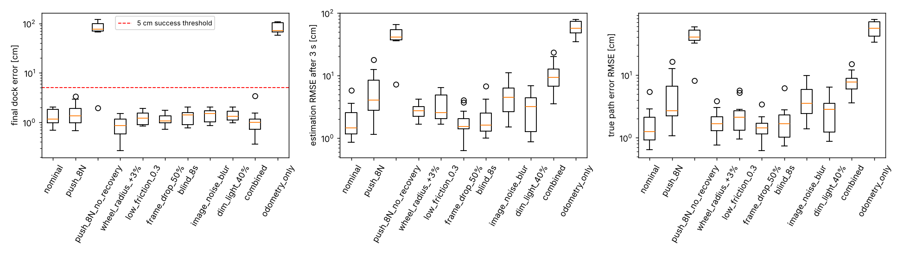

Example trial with the estimate, its 3σ ellipse and the truth (the error panels show estimate − truth with ±3σ, and green ticks mark frames where a marker was seen):

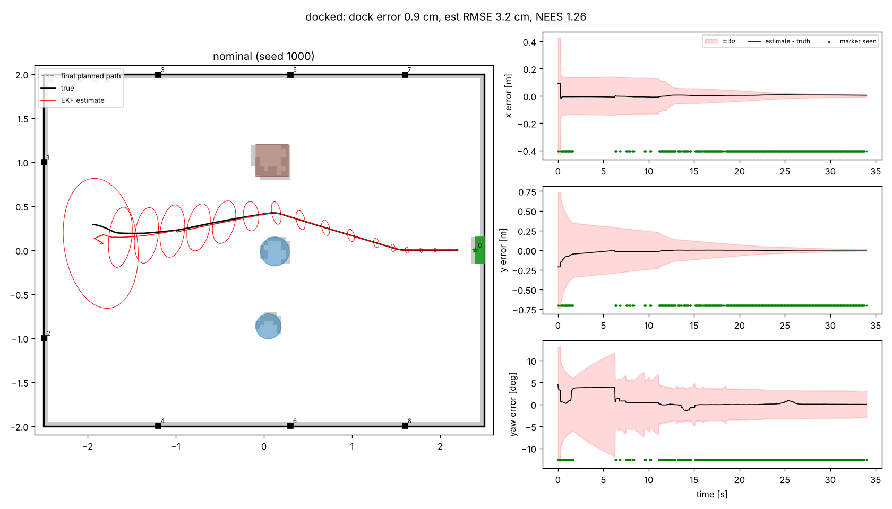

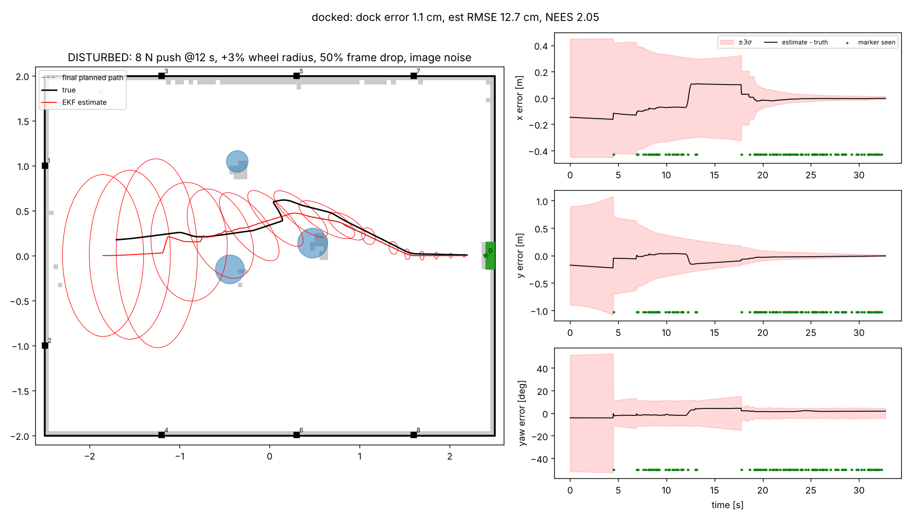

**What the results show.**

* **Nominal:** 15/15 docked, 1.4 cm dock error, 2.0 cm estimation RMSE after the first fix, NEES 1.6 with 98% of steps inside the bound. NEES below 3 means the filter is slightly conservative here, which is the price of choosing k_R = 10 on a disturbed condition. The 17 cm maximum estimation error is the start-pad prior before the first marker fix.
* **The camera does the localising.** Odometry-only fails every trial (82 cm dock error) even though its NEES is consistent (1.7). Its uncertainty is honest but large, because nothing removes the ±0.3 m start prior or the heading drift (yaw RMSE 10.5°).
* **Encoder-model violations** (radius +3%, friction 0.3) roughly double the estimation RMSE (2.8 and 3.4 cm) but keep NEES near 3, because Q scales with wheel travel and absorbs them. Docking is unaffected.
* **Losing the camera** (50% frame drop, or fully blind for 8 s mid-route) barely changes anything. Odometry over 8 s at 0.15 m/s (1.2 m) drifts by less than the 3σ band, and markers re-acquire inside the gate. Image noise plus blur cuts accepted marker updates by about 40% (185 vs 303 per run) and raises RMSE to 5.1 cm. It still docks every time.
* **The push** is the only single disturbance that needs the recovery mechanism. The `push_8N_no_recovery` row is the evidence for it.
* **Combined** (push, radius error, friction 0.6, frame drop, image noise, all at once): 15/15 docked at 1.1 cm, but the estimate is visibly stressed. RMSE is 10.8 cm, yaw RMSE 9.7°, NEES 14 with 89% inside the bound, the bumper fires, and six runs touch an obstacle. This is the edge of the operating envelope.
* **Why docking is more accurate than the mid-route estimate.** On the final 0.65 m the dock marker spans 40 px or more in the image, the measured range noise at that distance is about 1 mm, and the robot slows to 0.08 m/s. The single-marker null space (Section 4) is the remaining risk. In the first batch, seed 1014 of the combined condition showed lateral and yaw errors coupled on the approach exactly as the null-space direction predicts (about 17 cm lateral with −10° yaw, about 0.9 m from the dock marker, with only that marker in view). In the final batch the same seed docks with 3.4 cm position error and a **9.99°** heading error: inside the 10° criterion by a hair, and the one marginal success in the whole batch.

## 9. Limitations (what the results do and do not support)

* **Simulation only.** The rendered camera is cleaner than a real one: no motion blur, no rolling shutter, no lens distortion, and a bearing error of 0.026°. The 2× inflation, the floors and k_R = 10 are engineering choices validated by NEES in *this* simulator. A real camera would need re-characterisation.
* **Landmark map assumed exact.** A real deployment would need surveyed marker poses, or would have to estimate them (EKF-SLAM).
* **LiDAR is used only for mapping and planning, not localisation.** Scan matching against the map would give a second absolute pose source and would make the single-marker null space irrelevant.
* **The covariance-reset recovery** treats "persistent gate failure" as estimator error. A genuinely wrong detection that persisted for 0.3 s (e.g. a duplicate marker id) would be accepted after the reset. With unique ids that never happened here, but it is a real failure mode.
* **The controller is gain-scheduled on the linearisation.** There is no stability proof for large errors. The deadlock found above is one symptom, and the progress floor is a heuristic fix, not a guarantee.
* **Statistics.** 15 seeds per robustness condition and 7 per sweep point give wide confidence intervals for rare failures. A 0/15 failure count bounds the true failure rate below roughly 20% (95%), not at zero.

## 10. References and acknowledgements

1. Y. Kanayama, Y. Kimura, F. Miyazaki, T. Noguchi, "A stable tracking control method for an autonomous mobile robot," *Proc. IEEE ICRA*, 1990. (tracking-error model)
2. R. W. Brockett, "Asymptotic stability and feedback stabilization," in *Differential Geometric Control Theory*, Birkhäuser, 1983.
3. S. Thrun, W. Burgard, D. Fox, *Probabilistic Robotics*, MIT Press, 2005. (odometry noise model, EKF localisation, log-odds occupancy grids)
4. Y. Bar-Shalom, X. R. Li, T. Kirubarajan, *Estimation with Applications to Tracking and Navigation*, Wiley, 2001. (NEES/NIS consistency tests)
5. MuJoCo documentation (mujoco.readthedocs.io), OpenCV ArUco and camera-calibration documentation, ROBOTIS TurtleBot3 Burger and LDS-01 specifications.

Weekly tutorial material: no tutorial code was copied; the pipeline was written for this project.

## 11. Individual contributions

| member | contribution |
|---|---|
| Ferdinand Auld | sole member: all components |

## 12. Generative AI declaration

Claude (Anthropic) was used to generate the simulation scene, sensor pipeline, EKF, planner, controller, experiment scripts, results and a draft of this page. I chose the track, directed the work, ran the code, checked the reported numbers against the result files, and am responsible for the submission.
